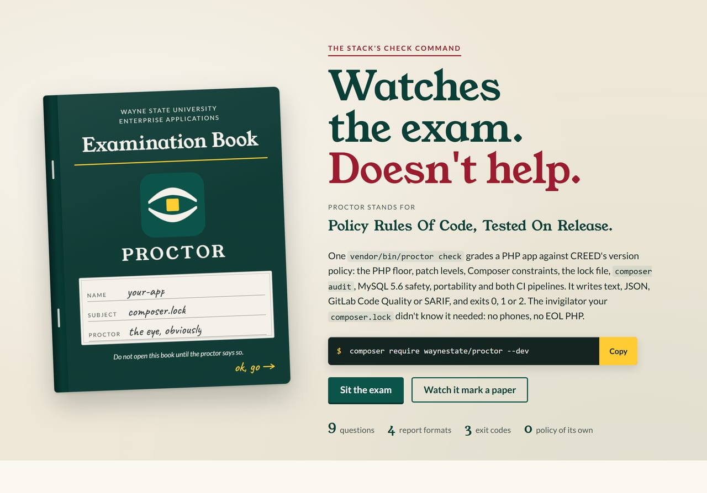
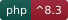
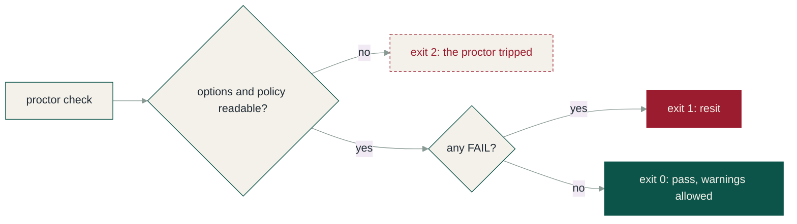
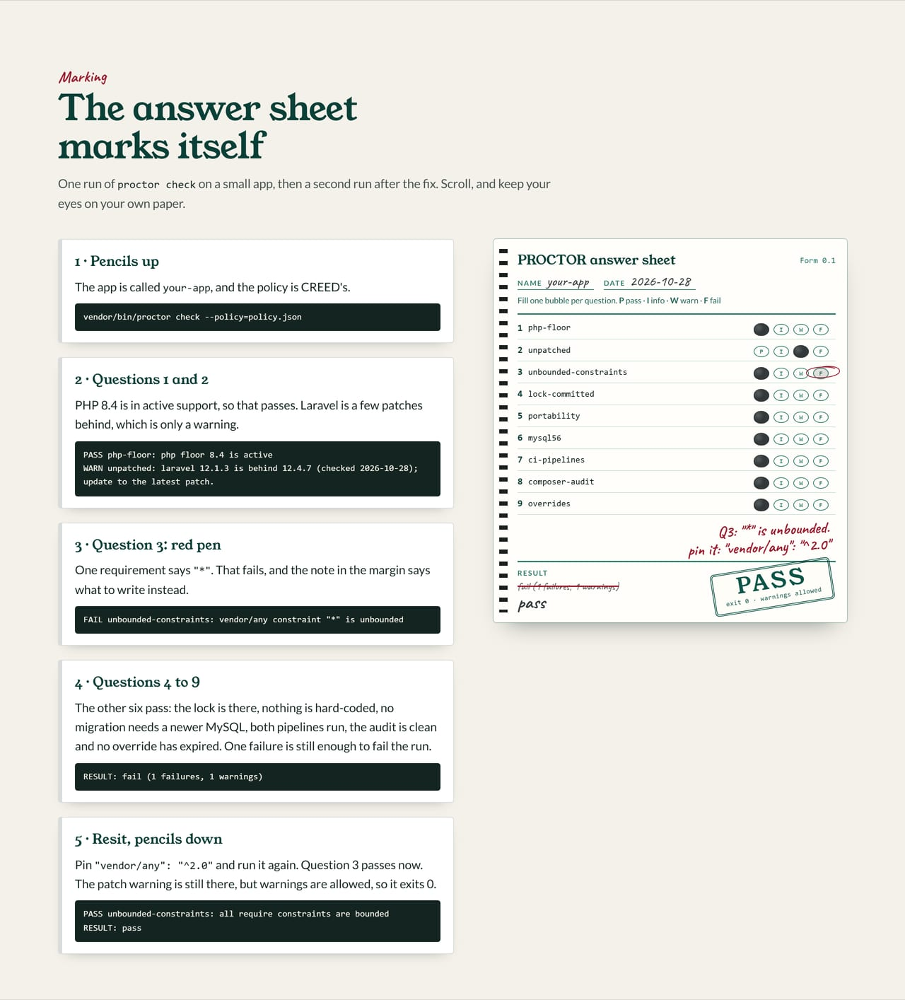
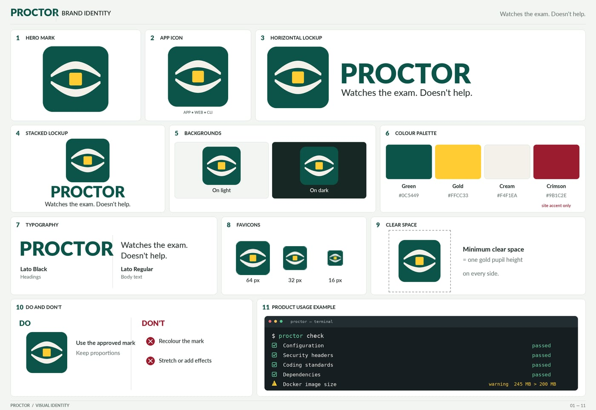

<div align="center">
  <a href="site/index.html"></a>
</div>

# PROCTOR

<p>
  
  
  
  <a href="https://github.com/waynestate/proctor/actions/workflows/ci.yml"></a>
</p>

**Policy Rules Of Code, Tested On Release.** The invigilator your composer.lock didn't know it needed: no phones,
no EOL PHP.

PROCTOR is a framework-free PHP CLI that measures a PHP application against
the WSU version policy. It reads the app's composer.json and composer.lock,
decides the support state of the app's PHP floor from a policy file, and
reports each check as pass, warning, info or fail. The checks and their rules
come from the stack's version policy decision and from the policy file
passed with `--policy`; PROCTOR itself holds no policy of its own.

Checks: `composer ci` (the same command runs on GitLab and GitHub). Front page: [`site/index.html`](site/index.html).

> [!NOTE]
> This repository is published from Wayne State University's internal GitLab and mirrored here. Changes land there
> first; Wayne State developers open issues and merge requests on the internal project.

## Install

```
composer require waynestate/proctor --dev
```

The command is then `vendor/bin/proctor`.

## Single-file download

PROCTOR can also be built as a single-file PHAR, so PREFLIGHT and apps without
Composer access can run it as one file. Build it with the script for your OS
(both need Docker, and no PHP or Composer on the host):

Windows (PowerShell):

    .\scripts\build-phar.ps1

Linux / macOS:

    scripts/build-phar.sh

Each script writes `build/proctor.phar` and verifies it by printing PROCTOR's
version. The phar is not published yet — there is no release step — so build it
from a checkout rather than downloading it.

## Usage

```
vendor/bin/proctor check [--path=.] [--format=text|json|codequality|sarif] [--policy=<file>] [--today=YYYY-MM-DD] [--php-runtime=X.Y.Z]
```

- `--path`: path to the application to check (default `.`).
- `--format`: output format: `text` (default), `json`, `codequality`, or `sarif`.
- `--policy`: path to the CREED-format policy file (required).
- `--today`: override today's date (YYYY-MM-DD) so runs are deterministic.
- `--php-runtime`: the PHP version that will serve the app (X.Y.Z), used by the `unpatched` check. CI should pass the deploy image's PHP, not the runner's.

## Checks

<div align="center">
  
</div>
<div align="center"><sub>Nine questions, asked in this order on every run. The lines are real output from the test fixtures.</sub></div>

- `php-floor`: fails when the lowest PHP version allowed by `require.php` is past security support plus the grace window, or when composer.json has no usable php constraint.
- `unpatched`: warns when a locked component is behind the policy's `latest_patch` for its version line, and passes when it is current. Reads laravel from composer.lock (`laravel/framework`), vue and inertia from package-lock.json (`vue`, `@inertiajs/vue3`), and the PHP runtime from `--php-runtime`. No finding when the component, its version line, or `latest_patch` is absent from the policy.
- `unbounded-constraints`: fails for every runtime constraint that is `*` or names a dev- branch.
- `lock-committed`: fails when composer.lock is missing from the app path.
- `portability`: warns when code hard-codes a platform fact: an absolute host path, a hard-coded proxy address, a local-disk session store, or a php_value/php_flag line in .htaccess.
- `mysql56`: warns when migrations or app code use MySQL features the shared 5.6 server rejects: JSON columns and JSON queries, generated columns, `renameColumn`/`renameIndex`, vector, invisible and spatial columns, `Schema::hasColumn`-style introspection, raw SQL with 5.7+ syntax, the upsert row alias, indexed strings over 191 characters, date columns defaulting to the current time, and the `db:show`/`db:monitor` commands. Citadel's shared MySQL server is 5.6, so migrations must avoid newer features. Warnings, not failures: an app on its own newer database is not affected. Fix by avoiding the feature (a raw `ALTER TABLE ... CHANGE` instead of `renameColumn`, `timestamp` instead of a date column defaulting to now, `Schema::defaultStringLength(191)` in `boot()`) or by moving the app to its own database.
- `destructive-deploy`: fails when a deploy script runs an artisan command that drops or rebuilds the database (`migrate:fresh`, `migrate:refresh`, `migrate:reset`, `db:wipe`), which erases production data on every deploy. Scans `.sh` and `.php` files under a top-level `deployments/`, `deploy_scripts/`, `deploy/` or `scripts/` directory, the top-level `build.sh`, `release.sh` and `.gitlab-ci.yml`, and the `scripts` section of composer.json; shell comments are ignored. Fix by running plain `php artisan migrate --force` in the deploy.
- `ci-pipelines`: for stack packages (composer.json `name` starting with `waynestate/`), fails when `.gitlab-ci.yml` or `.github/workflows/ci.yml` is missing or runs no `composer ci`; for any other project, a missing or incomplete `.gitlab-ci.yml` is a warning and `.github/workflows/ci.yml` is optional. Warns when a GitHub `uses:` ref is not a 40-hex commit SHA. The proctor fails the stack's own exam halls, and only leaves a note for everyone else's.
- `composer-audit`: fails for advisories at or above the policy's `audit_severity_threshold`, warns for lower ones, and reports info when composer or the lock file is absent.
- `composer-version`: fails when the Composer on PATH carries the command-injection holes CVE-2024-35241 and CVE-2024-35242 — 2.2.x below 2.2.24, or any other 2.x below 2.7.7 — or is Composer 1, which is end of life; warns when composer cannot be run. The invigilator checks its own pen: [GHSA-47f6-5gq3-vx9c](https://github.com/advisories/GHSA-47f6-5gq3-vx9c) and [GHSA-v9qv-c7wm-wgmf](https://github.com/advisories/GHSA-v9qv-c7wm-wgmf).
- `overrides`: fails for every expired entry in policy-overrides.json.

## Exit codes

- `0`: pass (warnings allowed)
- `1`: one or more failures
- `2`: tool error (bad options, unreadable policy, malformed composer.json or overrides file)



<details>
<summary><b>Watch it mark a paper</b>: the answer sheet from the front page, handed over finished</summary>
<br>
<div align="center"></div>
</details>

## Formats

- `text`: a header line with the tool and the versions of the external tools used (composer), then one line per finding, then one line per override, then a RESULT line.
- `json`: one machine-readable object with tool, version, path, today, result, exit, tools, findings and overrides.
- `codequality`: GitLab's Code Quality JSON: a single array of findings, so a merge request shows them.
- `sarif`: a SARIF 2.1.0 log: one run, one rule per check, one result per non-pass finding, so GitHub code scanning and other SARIF viewers show them.

## GitHub code scanning

The `sarif` format feeds GitHub code scanning on the GitHub mirror. Upload the
log with the official action, pinned to a full commit SHA:

```yaml
name: proctor
on: [push, pull_request]
permissions:
  security-events: write
jobs:
  proctor:
    runs-on: ubuntu-latest
    steps:
      - uses: actions/checkout@v4
      - uses: shivammathur/setup-php@v2
        with:
          php-version: '8.4'
      - run: composer require waynestate/proctor --dev
      # policy.json is the CREED policy file
      - run: vendor/bin/proctor check --format=sarif --policy=policy.json > proctor.sarif
      - uses: github/codeql-action/upload-sarif@9b3254085494b55a0f7c4c2b3d2d52cc712ce370 # v4.39.1
        with:
          sarif_file: proctor.sarif
```

PROCTOR now files the mark sheet in the format the head office already reads —
no more translating the exam results by hand.

## Overrides

An app can carry a `policy-overrides.json` file next to its composer.json:

```json
[
    {
        "check": "lock-committed",
        "reason": "lock is generated by CI and not committed",
        "expires": "2027-01-31",
        "approved_by": "jane@example.wayne.edu"
    }
]
```

An expired override fails the `overrides` check. An active override turns the
check's fail findings into warnings. An override never waives a failure whose
state is EOL plus grace (eol_grace_expired); that failure stands (the stack's version policy decision).

## Policy

`--policy` takes a CREED-format policy file: schema_version 1, component
versions with released, active_until and security_until dates, and rules
(audit_severity_threshold, banned_constraints, eol_grace_days). The
policy-file wiring to `waynestate/creed` follows its v0.1.0 tag.

## Running the tests in Docker

No PHP is needed on the host:

```
docker run --rm -v "${PWD}:/app" -w /app composer:2 composer install --no-interaction
docker run --rm -v "${PWD}:/app" -w /app php:8.4-cli vendor/bin/phpunit
```

The same works with `php:8.3-cli` in place of `php:8.4-cli`.

Strongly recommended: a git.wayne.edu instance runner.

## Licence

MIT, Wayne State University, Enterprise Applications.

<details>
<summary><b>The brand board</b>: the mark, lockups, palette and type</summary>
<br>
<div align="center"></div>
</details>

<div align="center"><b>Seated in the same hall</b><br><sub>WayneUI and the stack. Each one sits its own exam.</sub></div>

<div align="center">
  <a href="https://github.com/waynestate/wayne-ui" title="WayneUI"><picture><source media="(prefers-color-scheme: dark)" srcset="docs/readme/cast/wayneui-dark.png"></picture></a>
  <a href="https://github.com/waynestate/creed" title="CREED"></a>
  <a href="https://github.com/waynestate/proctor" title="PROCTOR"></a>
  <a href="https://github.com/waynestate/sesame" title="SESAME"></a>
  <a href="https://github.com/waynestate/helmet" title="HELMET"></a>
  <a href="https://github.com/waynestate/sourdough" title="Sourdough"></a>
  <a href="https://github.com/waynestate/squire" title="SQUIRE"></a>
  <a href="https://github.com/waynestate/preflight" title="PREFLIGHT"></a>
  <a href="https://github.com/waynestate/pinstripe" title="Pinstripe"></a>
  <a href="https://github.com/waynestate/booster" title="BOOSTER"></a>
  <a href="https://github.com/waynestate/rollcall" title="ROLLCALL"></a>
  <a href="https://github.com/waynestate/drawbridge" title="DRAWBRIDGE"></a>
  <a href="https://github.com/waynestate/advisor" title="ADVISOR"></a>
  <a href="https://github.com/waynestate/weld" title="WELD"></a>
</div>

<div align="center"><sub>Images are regenerated from the front page by <a href="scripts/readme-art/README.md"><code>scripts/readme-art</code></a>. Pencils down.</sub></div>
