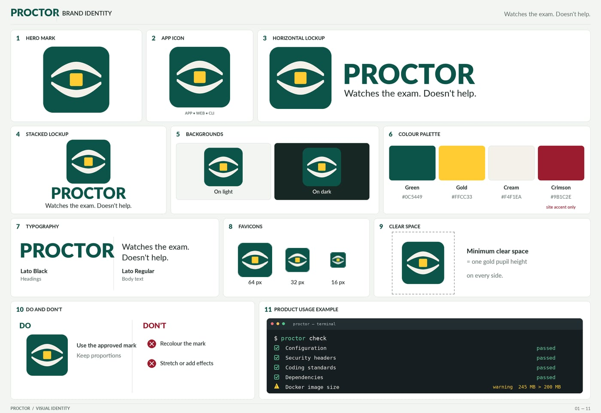

# PROCTOR

This page says what PROCTOR is and how to run it.

> **Policy Rules Of Code, Tested On Release.** The invigilator your composer.lock didn't know it needed: no phones,
> no EOL PHP.

Checks: `composer ci` (the same command runs on GitLab and GitHub). Front page: [`site/index.html`](https://github.com/waynestate/proctor/blob/main/site/index.html).
On Citadel it is served by the raw-PHP deploy layer in [`deploy/`](https://github.com/waynestate/proctor/tree/main/deploy): a Squire kit whose front controller serves `site/` behind HELMET's security headers. For local development, keep serving `site/` directly.

PROCTOR is a framework-free PHP CLI that measures a PHP application against
the WSU version policy. It reads the app's composer.json and composer.lock,
decides the support state of the app's PHP floor from a policy file, and
reports each check as pass, warning, info or fail. The checks and their rules
come from the stack's version policy decision and from the policy file
passed with `--policy`; PROCTOR itself holds no policy of its own.

> **Not to be confused with:** code style is Pinstripe, CI is Preflight. PROCTOR grades an app against CREED's rules.

<div align="center">
  
</div>
<div align="center"><sub>Nine of the seventeen checks shown, asked in this order on every run; `policy-age` stays silent while the policy is fresh. The lines are real output from the test fixtures.</sub></div>

## Where the code lives

The canonical repository is on nougat: [enterprise-apps/proctor](https://nougat.snu.gs/enterprise-apps/proctor). git.wayne.edu and GitHub ([waynestate/proctor](https://github.com/waynestate/proctor)) are read-only mirrors of it.
Open issues and merge requests on nougat, not on the mirrors.
This moves to git.wayne.edu once it has CI runners. Your proctor keeps one answer sheet, and this is it; the mirrors hold photocopies.

## Install

```
composer require waynestate/proctor --dev
```

The command is then `vendor/bin/proctor`.

## Commands

<!-- generated:commands -->
| Command | What it does |
| --- | --- |
| `proctor check` | Measure a PHP app against the version policy. |

### `proctor check`

Measure a PHP app against the version policy.

Usage: `proctor check [--path PATH] [--format FORMAT] [--policy POLICY] [--today TODAY] [--php-runtime PHP-RUNTIME] [--timeout TIMEOUT]`

| Option | Meaning | Default |
| --- | --- | --- |
| `--path=VALUE` | Path to the application to check. | `.` |
| `--format=VALUE` | Output format (text, json, codequality, sarif). | `text` |
| `--policy=VALUE` | Path to the CREED-format policy file. Without it, PROCTOR checks the PROCTOR_POLICY environment variable, then the app's vendor/waynestate/creed/policy/policy.json, then its own bundled copy. |  |
| `--today=VALUE` | Override today's date (YYYY-MM-DD). |  |
| `--php-runtime=VALUE` | The PHP version that will serve the app (X.Y.Z), for the unpatched check. |  |
| `--timeout=VALUE` | Maximum seconds for composer audit before it is killed. | `300` |
| `--silent` | Do not output any message |  |

### Options every command accepts

| Option | Meaning | Default |
| --- | --- | --- |
| `-h`, `--help` | Display help for the given command. When no command is given display help for the <info>list</info> command |  |
| `-q`, `--quiet` | Only errors are displayed. All other output is suppressed |  |
| `-v|-vv|-vvv`, `--verbose` | Increase the verbosity of messages: 1 for normal output, 2 for more verbose output and 3 for debug |  |
| `-V`, `--version` | Display this application version |  |
| `--ansi` | Force (or disable --no-ansi) ANSI output |  |
| `--no-ansi` | Negate the "--ansi" option |  |
| `-n`, `--no-interaction` | Do not ask any interactive question |  |
<!-- /generated -->

## Environment

<!-- generated:env -->
| Variable | Meaning | Default | Read in |
| --- | --- | --- | --- |
| PROCTOR_POLICY | Path to a CREED-format policy file; tried before the app's vendor copy and the bundled copy when --policy is absent | none | src/Policy/PolicyResolver.php |
<!-- /generated -->

<div align="center"><b>Seated in the same hall</b><br><sub>WayneUI and the stack. Each one sits its own exam.</sub></div>

<div align="center">
  <a href="https://github.com/waynestate/wayne-ui" title="WayneUI"></a>
  <a href="https://github.com/waynestate/creed" title="CREED"></a>
  <a href="https://github.com/waynestate/proctor" title="PROCTOR"></a>
  <a href="https://github.com/waynestate/sesame" title="SESAME"></a>
  <a href="https://github.com/waynestate/helmet" title="HELMET"></a>
  <a href="https://github.com/waynestate/sourdough" title="Sourdough"></a>
  <a href="https://github.com/waynestate/squire" title="Squire"></a>
  <a href="https://github.com/waynestate/preflight" title="Preflight"></a>
  <a href="https://github.com/waynestate/pinstripe" title="Pinstripe"></a>
  <a href="https://github.com/waynestate/booster" title="Booster"></a>
  <a href="https://github.com/waynestate/rollcall" title="Rollcall"></a>
  <a href="https://github.com/waynestate/drawbridge" title="Drawbridge"></a>
  <a href="https://github.com/waynestate/advisor" title="ADVISOR"></a>
  <a href="https://github.com/waynestate/weld" title="WELD"></a>
</div>

<div align="center"><sub>Images are regenerated from the front page by <a href="https://github.com/waynestate/proctor/tree/main/scripts/readme-art"><code>scripts/readme-art</code></a>. Pencils down.</sub></div>

<details>
<summary><b>The brand board</b>: the mark, lockups, palette and type</summary>
<br>

</details>
