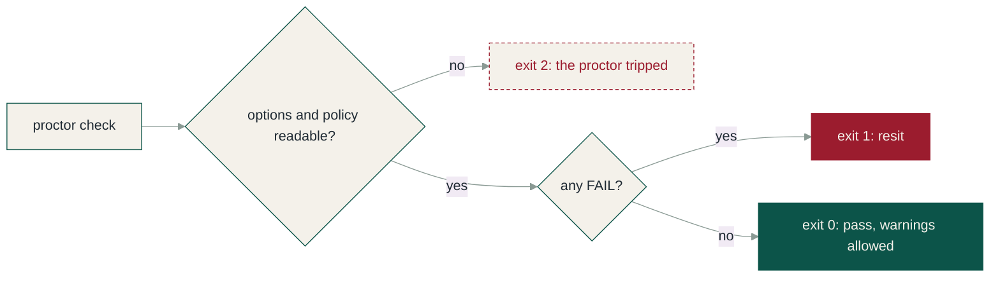

# Exit codes[#](https://proctor.apps.wayne.edu/docs/reference/exit-codes.html#exit-codes)

This page lists the three exit codes `proctor check` and `proctor gate` end with and exactly when each one happens, so a pipeline can branch on the right one. The proctor hands back the mark sheet and leaves the hall; the code is the only word it says out loud. For what feeds the verdict, see [Rule ids](https://proctor.apps.wayne.edu/docs/reference/rule-ids.html) and the [checks overview](https://proctor.apps.wayne.edu/docs/guides/checks-overview.html).

## Codes[#](https://proctor.apps.wayne.edu/docs/reference/exit-codes.html#codes)

| Exit code | Meaning |
| --- | --- |
| `0` | pass (warnings allowed) |
| `1` | one or more failures |
| `2` | tool error (bad options, unreadable policy, a present but malformed or unreadable composer.json, an overrides file that is malformed, unreadable, or names a check that is not registered or the overrides check itself, or a `--record` file it could not write) |

A missing composer.json is not a tool error: the app gets a verdict, with php-floor failing.

On a tool error every format still writes its report to stdout, next to the message on stderr: `text` prints the message as a FAIL line, `json` writes the report shape with `result` set to `error`, an `error` field carrying the message and empty findings, `codequality` lists the error as one blocker issue, and `sarif` writes a log whose single run reports an unsuccessful invocation. A pipeline can read the reason from the report instead of only from stderr.

## proctor gate[#](https://proctor.apps.wayne.edu/docs/reference/exit-codes.html#proctor-gate)

The deploy gate uses the same three numbers with deploy words (see [Deploy gate](https://proctor.apps.wayne.edu/docs/guides/deploy-gate.html)):

| Exit code | Meaning |
| --- | --- |
| `0` | go: nothing blocked (held and waived failures, warnings allowed) |
| `1` | no-go: a failure is blocked (a first deploy, a regression against the baseline, or an expired override) |
| `2` | the gate could not decide (the tool errors above, plus a missing or malformed `--baseline` or a `--record` file it could not write); a platform hook fails open on it |

On exit 2 the gate writes its verdict in the selected format: the JSON verdict with `verdict` set to `error`, or, for `text`, the verdict line, a FAIL line carrying the message, and a RESULT line.

## How a run ends[#](https://proctor.apps.wayne.edu/docs/reference/exit-codes.html#how-a-run-ends)

## Watch it mark a paper[#](https://proctor.apps.wayne.edu/docs/reference/exit-codes.html#watch-it-mark-a-paper)

The answer sheet from the front page, handed over finished:

## Related[#](https://proctor.apps.wayne.edu/docs/reference/exit-codes.html#related)

- [Commands](https://proctor.apps.wayne.edu/docs/reference/commands.html)
- [Rule ids](https://proctor.apps.wayne.edu/docs/reference/rule-ids.html)
- [Formats](https://proctor.apps.wayne.edu/docs/guides/formats.html)
- [Troubleshooting](https://proctor.apps.wayne.edu/docs/troubleshooting.html)
